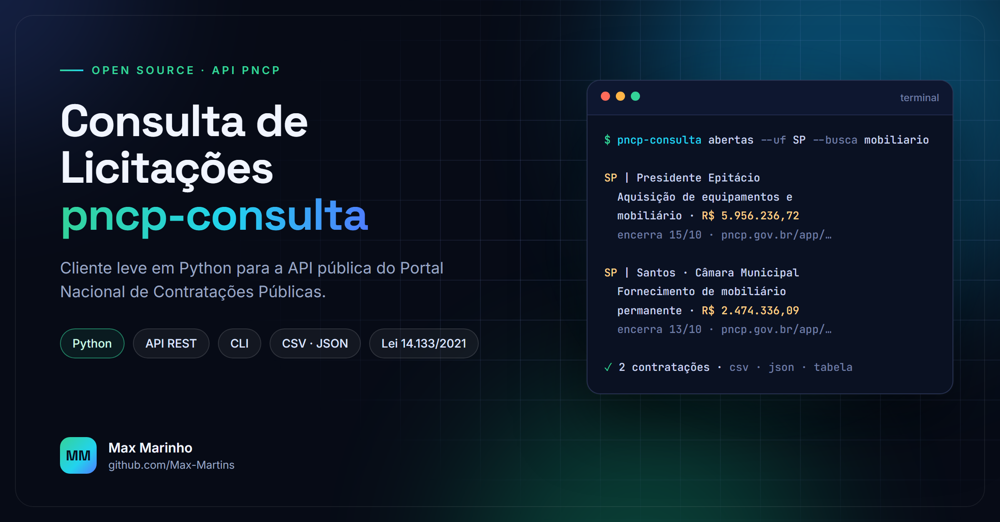
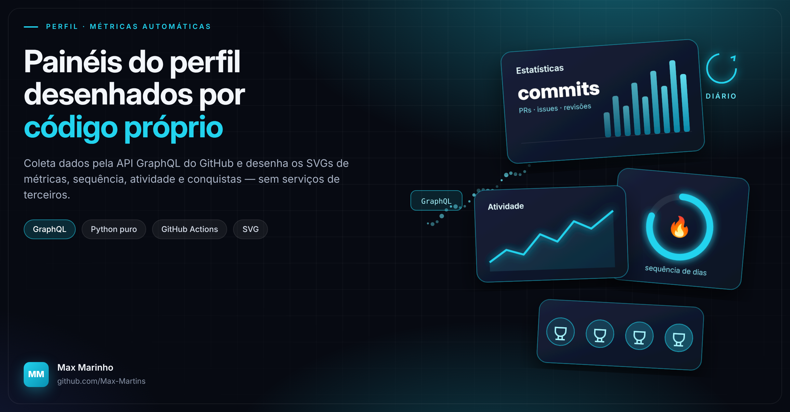
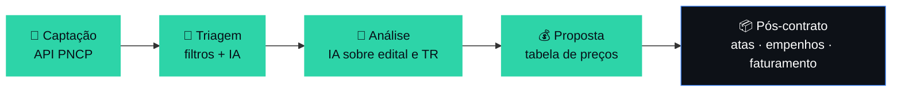

## Sobre mim

Sou **Analista de Licitação** e trabalho com **compras públicas e automação**. Meu dia a dia é edital, termo de referência, proposta e prazo. Meu foco é tirar o trabalho repetitivo desse ciclo e transformar em fluxo automatizado, auditável e versionado.

- 🎯 **Foco atual:** captação e triagem de pregões pela API do PNCP
- 🛠️ **Construindo:** fluxos em n8n com JavaScript e Python, rodando em Docker
- 🤖 **Explorando:** IA (Claude, Codex, MCP) para ler editais e cruzar itens com tabelas de preço
- ⚖️ **Base:** Lei nº 14.133/2021 e a rotina real de quem participa de licitação

> **Menos tarefa repetitiva. Mais automação. Mais tempo para as decisões que importam.**

---

## Projetos

<table>
<tr>
<td width="50%" valign="top">

### 📡 licitacoes-pncp-ia

Captação de licitações de ponta a ponta: busca no PNCP, filtra, lê o edital com IA, cruza os itens com a sua tabela de preços e entrega Excel, proposta prévia e declarações por e-mail.

- Instalação com 2 cliques (Windows) ou 1 comando (macOS/Linux)
- Adaptável a qualquer ramo, sem programar
- Testado a cada atualização, inclusive no Docker

`n8n` `Python` `Docker` `Claude` `Gemini`

[**Repositório →**](https://github.com/Max-Martins/licitacoes-pncp-ia)

</td>
<td width="50%" valign="top">

### 🤖 compras-publicas-mcp

Servidor MCP que dá à sua IA acesso ao PNCP e ao Compras.gov.br: propostas abertas, itens, documentos, atas, CATMAT e pesquisa de preços, direto da conversa.

- Somente leitura, com fonte e data em cada resposta
- Zero dependências, sem chave de API
- Claude, ChatGPT/Codex, Cursor e VS Code

`MCP` `Node.js` `PNCP` `CATMAT`

[**Repositório →**](https://github.com/Max-Martins/compras-publicas-mcp)

</td>
</tr>
<tr>
<td width="50%" valign="top">

### 🔎 pncp-consulta

Cliente leve em Python para a **API pública do PNCP**: lista licitações com proposta aberta, filtra pelo objeto e exporta para planilha, direto do terminal.

- Zero dependências (biblioteca padrão)
- Paginação automática e novas tentativas
- CSV pronto para o Excel em português

`Python` `API PNCP` `CLI`

[**Repositório →**](https://github.com/Max-Martins/pncp-consulta)

</td>
<td width="50%" valign="top">

### 📊 Profile Cards

Gerador próprio dos painéis deste perfil. Coleta os dados pela **API GraphQL do GitHub** e desenha os SVGs de métricas, sequência, atividade e conquistas, sem serviços de terceiros.

- Python puro (biblioteca padrão)
- Atualização diária via GitHub Actions

`Python` `GraphQL` `SVG`

[**Código →**](./scripts/generate_cards.py)

</td>
</tr>
</table>

---

## Automação no ciclo da licitação

Onde cada ferramenta entra, do edital publicado ao pós-contrato:

🟩 já automatizado no <a href="https://github.com/Max-Martins/licitacoes-pncp-ia">licitacoes-pncp-ia</a> &nbsp;·&nbsp; 🟦 próximo passo

---

## Stack

---

## GitHub em números

<b>🏆 Ver conquistas</b>

 

 

Painéis gerados diariamente por <a href="./scripts/generate_cards.py">generate_cards.py</a>. Animação da cobrinha gerada com <a href="https://github.com/Platane/snk">Platane/snk</a>; o <a href="./jogo/index.html">jogo</a> é próprio.

---

## Apoie

Os projetos são gratuitos e abertos. Se algum deles economizou o seu tempo, deixe uma ⭐ ou apoie com um PIX de qualquer valor.

---

## Vamos conversar

Quer trocar ideias sobre automação de licitações, integração com o PNCP, n8n ou IA aplicada?

 

  

